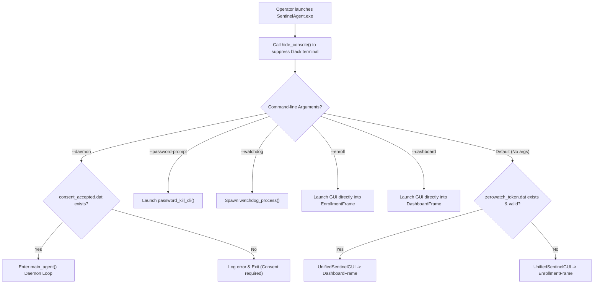
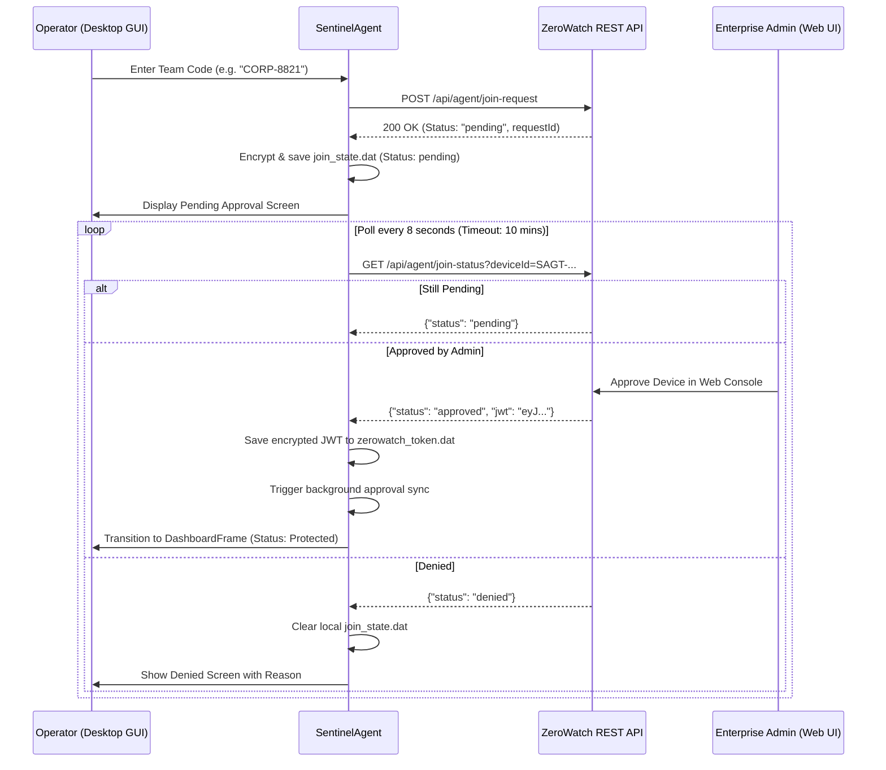
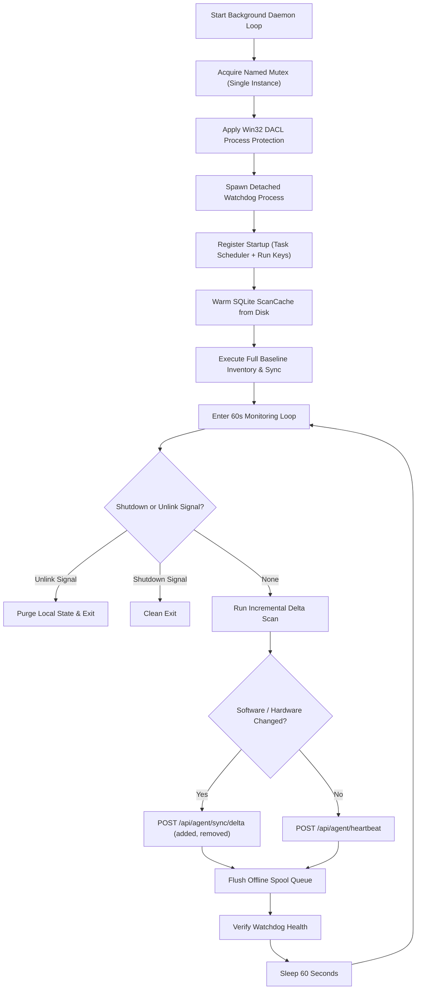
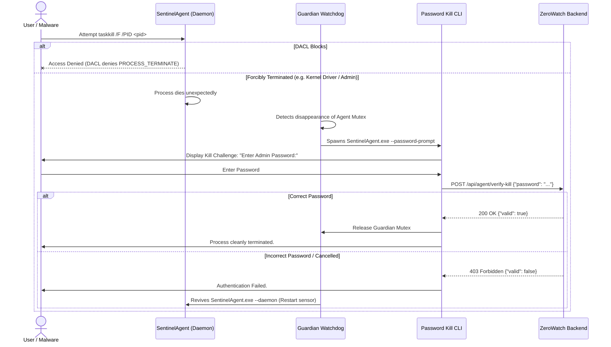

# ZeroWatch SentinelAgent: Master Technical Reference & Specification

This document provides the exhaustive, authoritative technical documentation for the **ZeroWatch SentinelAgent** endpoint sensor located in [`Zerowatch-EXE`](file:///c:/Users/admin/Desktop/deepcytes/zerowatch-site/Zerowatch-EXE). It covers the complete file structure, detailed function-by-function and class-by-class references, comprehensive feature descriptions for both the Frontend (Desktop GUI) and Backend (Sensor Daemon & Network Engine), and end-to-end operational workflows.

---

## Table of Contents

1. [Complete File & Directory Structure](#1-complete-file--directory-structure)
2. [Frontend Architecture & Features (`UnifiedSentinelGUI`)](#2-frontend-architecture--features-unifiedsentinelgui)
   - [2.1 UI Architecture & Window Management](#21-ui-architecture--window-management)
   - [2.2 Enrollment Frame (`EnrollmentFrame`)](#22-enrollment-frame-enrollmentframe)
   - [2.3 Dashboard Frame (`DashboardFrame`)](#23-dashboard-frame-dashboardframe)
   - [2.4 Interactive Charts & Real-Time Telemetry Cards](#24-interactive-charts--real-time-telemetry-cards)
3. [Backend Architecture & Features (Sensor & Communications Engine)](#3-backend-architecture--features-sensor--communications-engine)
   - [3.1 Network Engine & REST Client (`ZeroWatchClient`)](#31-network-engine--rest-client-zerowatchclient)
   - [3.2 Real-Time Eventing Engine (Socket.IO)](#32-real-time-eventing-engine-socketio)
   - [3.3 Offline Request Spooler & Retry Engine](#33-offline-request-spooler--retry-engine)
   - [3.4 3-Layer Scanning Engine (`ScanOrchestrator`)](#34-3-layer-scanning-engine-scanorchestrator)
   - [3.5 SQLite State Caching Engine (`ScanCache`)](#35-sqlite-state-caching-engine-scancache)
   - [3.6 Security, Cryptography & Hardware Fingerprinting](#36-security-cryptography--hardware-fingerprinting)
   - [3.7 Process Self-Defense & Guardian Watchdog](#37-process-self-defense--guardian-watchdog)
   - [3.8 Startup Persistence Managers](#38-startup-persistence-managers)
4. [Exhaustive Function & Method Reference](#4-exhaustive-function--method-reference)
   - [4.1 `sentinel_agent.py` Functions & Classes](#41-sentinel_agentpy-functions--classes)
   - [4.2 `scanner/` & `common/scanner/` Functions & Classes](#42-scanner--commonscanner-functions--classes)
   - [4.3 `platforms/factory.py` & `common/platform.py`](#43-platformsfactorypy--commonplatformpy)
   - [4.4 `windows/` Package Functions & Classes](#44-windows-package-functions--classes)
   - [4.5 `linux/` Package Functions & Classes](#45-linux-package-functions--classes)
   - [4.6 `macos/` Package Functions & Classes](#46-macos-package-functions--classes)
   - [4.7 Supporting Tools & Scripts](#47-supporting-tools--scripts)
5. [End-to-End Operational Workflows](#5-end-to-end-operational-workflows)
   - [Workflow 1: Launch, Console Suppression & State Routing](#workflow-1-launch-console-suppression--state-routing)
   - [Workflow 2: Enterprise Team-Code Join-Request & Polling](#workflow-2-enterprise-team-code-join-request--polling)
   - [Workflow 3: Individual Direct Registration & PIN Pairing](#workflow-3-individual-direct-registration--pin-pairing)
   - [Workflow 4: Full System Baseline Inventory & Sync](#workflow-4-full-system-baseline-inventory--sync)
   - [Workflow 5: Background Daemon Monitoring & Delta Sync Loop](#workflow-5-background-daemon-monitoring--delta-sync-loop)
   - [Workflow 6: Real-Time WebSockets & Remote Command Handling](#workflow-6-real-time-websockets--remote-command-handling)
   - [Workflow 7: Offline Request Spooling & Auto-Replay](#workflow-7-offline-request-spooling--auto-replay)
   - [Workflow 8: Process Hardening, Watchdog & Authenticated Termination](#workflow-8-process-hardening-watchdog--authenticated-termination)
   - [Workflow 9: Device Unlinking & State Invalidation](#workflow-9-device-unlinking--state-invalidation)
   - [Workflow 10: Multi-Platform Build & Native Validation](#workflow-10-multi-platform-build--native-validation)

---

## 1. Complete File & Directory Structure

```
Zerowatch-EXE/
├── common/                                 # Cross-platform abstract base classes & shared utilities
│   ├── cert/                               # Certificate pinning logic
│   │   ├── __init__.py                     # Package export marker
│   │   └── pinning.py                      # SPKI SHA-256 certificate extraction & SSLContext patching
│   ├── crypto/                             # Secret storage interfaces
│   │   ├── __init__.py                     # Package export marker
│   │   └── interfaces.py                   # SecureStore ABC (encrypt / decrypt)
│   ├── persistence/                        # Startup persistence interfaces
│   │   ├── __init__.py                     # Package export marker
│   │   └── interfaces.py                   # PersistenceManager ABC (register_startup / unregister_startup)
│   ├── protection/                         # Process defense interfaces
│   │   ├── __init__.py                     # Package export marker
│   │   └── interfaces.py                   # ProcessGuard & EventLogger ABCs
│   ├── scanner/                            # Core scanner models & interfaces
│   │   ├── __init__.py                     # Package export marker
│   │   ├── fs_constants.py                 # Common paths, skip directories, & extensions
│   │   ├── interfaces.py                   # SoftwareCollector, BinaryInspector, FilesystemWalker ABCs
│   │   ├── layer2_manifests.py             # Parsers for npm, pip, cargo, go, maven, gradle, etc.
│   │   ├── models.py                       # SoftwareItem dataclass & normalization rules
│   │   └── state_cache.py                  # ScanCache SQLite implementation
│   ├── utils/                              # Shared utility helpers
│   │   ├── __init__.py                     # Package export marker
│   │   ├── sanitizers.py                   # Username, hostname, & organization name cleaners
│   │   └── time_.py                        # ISO-8601 UTC timestamp formatting
│   ├── platform.py                         # Abstract Platform container class
│   └── __init__.py                         # Package export marker
├── platforms/                              # Dynamic platform instantiation
│   ├── __init__.py                         # Package export marker
│   └── factory.py                          # PlatformFactory (routes win32, linux, darwin)
├── windows/                                # Windows native implementations
│   ├── crypto/                             # Windows DPAPI storage
│   │   ├── __init__.py                     # Package export marker
│   │   └── dpapi_store.py                  # CryptProtectData / CryptUnprotectData wrappers
│   ├── hardware/                           # Windows hardware enumeration
│   │   ├── __init__.py                     # Package export marker
│   │   ├── fingerprint.py                  # MachineGuid & deterministic SAGT- UUID derivation
│   │   └── hardware_collector.py           # WMI queries for CPU, RAM, GPU, Disks, Motherboard
│   ├── persistence/                        # Windows startup management
│   │   ├── __init__.py                     # Package export marker
│   │   └── startup_manager.py              # Registry Run keys & Task Scheduler (schtasks)
│   ├── protection/                         # Windows self-defense
│   │   ├── __init__.py                     # Package export marker
│   │   ├── event_logger.py                 # Windows Application Event Log emitter
│   │   └── process_guard.py                # Win32 DACL deny PROCESS_TERMINATE & console handlers
│   ├── scanner/                            # Windows scanner modules
│   │   ├── __init__.py                     # Package export marker
│   │   ├── binary_inspector.py             # PE header string extraction (VS_VERSIONINFO)
│   │   ├── filesystem_walker.py            # Windows fixed drive traversal engine
│   │   ├── fs_walker.py                    # Skip sets & drive enumerator
│   │   ├── layer0_registry.py              # HKLM/HKCU uninstall key parser & Windows Store apps
│   │   ├── layer1_paths.py                 # PE binary worker batch processor
│   │   └── software_collector.py           # WindowsSoftwareCollector composition
│   ├── platform.py                         # WindowsPlatform composition
│   └── __init__.py                         # Package export marker
├── linux/                                  # Linux native implementations
│   ├── crypto/                             # Linux secret storage
│   │   ├── __init__.py                     # Package export marker
│   │   └── secure_store.py                 # SecretService API & AES-256-GCM machine-bound vault
│   ├── hardware/                           # Linux hardware enumeration
│   │   ├── __init__.py                     # Package export marker
│   │   ├── fingerprint.py                  # /etc/machine-id & DMI product UUID derivation
│   │   └── hardware_collector.py           # /proc/cpuinfo, /proc/meminfo, lshw, sysfs
│   ├── persistence/                        # Linux startup management
│   │   ├── __init__.py                     # Package export marker
│   │   └── startup_manager.py              # Systemd unit generator & XDG autostart desktop entry
│   ├── protection/                         # Linux self-defense
│   │   ├── __init__.py                     # Package export marker
│   │   ├── event_logger.py                 # Journald & syslog audit emitter
│   │   └── process_guard.py                # POSIX signal traps (SIGTERM, SIGINT, SIGHUP)
│   ├── scanner/                            # Linux scanner modules
│   │   ├── __init__.py                     # Package export marker
│   │   ├── binary_inspector.py             # ELF header & package-ownership inspector
│   │   ├── filesystem_walker.py            # Linux root mount traversal engine
│   │   ├── file_watcher.py                 # inotify / polling file change monitor
│   │   ├── fs_walker.py                    # Mount point resolver & conditional skip logic
│   │   ├── package_collector.py            # dpkg, rpm, pacman, apk, snap, flatpak collectors
│   │   └── software_collector.py           # LinuxSoftwareCollector composition
│   ├── platform.py                         # LinuxPlatform composition
│   └── __init__.py                         # Package export marker
├── macos/                                  # macOS native implementations
│   ├── crypto/                             # macOS Keychain Services
│   │   ├── __init__.py                     # Package export marker
│   │   ├── keychain_backend.py             # CLI security command wrapper & in-memory test double
│   │   ├── secure_store.py                 # Tagged-reference slot manager
│   │   └── security_framework_backend.py   # Security.framework C bindings via ctypes
│   ├── hardware/                           # macOS hardware enumeration
│   │   ├── __init__.py                     # Package export marker
│   │   ├── fingerprint.py                  # IOPlatformExpertDevice UUID & sysctl hw.model
│   │   └── hardware_collector.py           # sysctl, system_profiler SPDisplaysDataType
│   ├── persistence/                        # macOS startup management
│   │   ├── __init__.py                     # Package export marker
│   │   └── startup_manager.py              # LaunchDaemon property list & launchctl manager
│   ├── protection/                         # macOS self-defense
│   │   ├── __init__.py                     # Package export marker
│   │   ├── event_logger.py                 # Apple System Log (ASL) / Unified Logging emitter
│   │   └── process_guard.py                # POSIX signal guard & shutdown event handling
│   ├── scanner/                            # macOS scanner modules
│   │   ├── __init__.py                     # Package export marker
│   │   ├── binary_inspector.py             # Mach-O load command & bundle ownership parser
│   │   ├── filesystem_walker.py            # macOS volume traversal engine
│   │   ├── fs_walker.py                    # Priority scan directories & skip rules
│   │   ├── macho.py                        # Mach-O magic numbers & architecture detection
│   │   ├── ownership.py                    # .app bundle, pkgutil, & Homebrew reverse mapping
│   │   ├── package_collector.py            # App bundle plists, pkgutil receipts, Homebrew, MacPorts
│   │   └── software_collector.py           # MacOSSoftwareCollector composition
│   ├── tests/                              # macOS test definitions
│   │   └── __init__.py                     # Package export marker
│   ├── validation/                         # Native validation suite
│   │   ├── __init__.py                     # Package export marker
│   │   ├── README.md                       # Validation harness instructions
│   │   └── validate_macos.py               # 17-stage one-shot native validation harness
│   ├── platform.py                         # MacOSPlatform composition
│   └── __init__.py                         # Package export marker
├── scanner/                                # 3-Layer Orchestrator & Forwarding Adapters
│   ├── __init__.py                         # Package export marker
│   ├── adapters.py                         # Adapter factory for default platform collectors
│   ├── fs_walker.py                        # Forwarding adapter to common/scanner/fs_walker
│   ├── layer0_registry.py                  # Forwarding adapter to common/scanner/layer0_registry
│   ├── layer1_paths.py                     # Forwarding adapter to common/scanner/layer1_paths
│   ├── layer2_manifests.py                 # Forwarding adapter to common/scanner/layer2_manifests
│   ├── models.py                           # Forwarding adapter to common/scanner/models
│   ├── orchestrator.py                     # ScanOrchestrator: layer scheduling, thread pool, & dedup
│   ├── README.md                           # Scanner technical documentation
│   └── state_cache.py                      # Forwarding adapter to common/scanner/state_cache
├── resources/                              # Binary & static assets
│   ├── favicon.ico                         # Windows executable & window icon
│   ├── favicon.png                         # Linux / macOS window icon
│   └── syft.exe                            # Syft CLI executable for on-demand SBOM generation
├── state/                                  # Runtime state files (created dynamically)
│   ├── scan_cache.db                       # SQLite scan cache
│   ├── unlink.signal                       # Signal file for local unlinking
│   ├── consent_accepted.dat                # Compliance gate token
│   └── zerowatch_token.dat                 # DPAPI/Keychain encrypted JWT token
├── sentinel_agent.py                       # Main Windows entry point, Tkinter GUI, & daemon orchestrator
├── sentinel_agent_linux.py                 # Linux entry point & background daemon
├── cert_pinning.py                         # Root forwarding adapter to common.cert.pinning
├── verify_pins.py                          # Build-time SPKI pin validator
├── test_cert_pinning.py                    # Certificate pinning unit test suite
├── build_agent.bat                         # Nuitka + Zig Windows compilation pipeline
├── build_agent_pyinstaller_enc.bat         # PyInstaller Windows pipeline with AES bytecode encryption
├── run_agent.sh                            # Linux launcher & daemon service script
├── validate_macos.sh                       # macOS native validation launcher wrapper
├── requirements-common.txt                 # Platform-independent runtime dependencies
├── requirements-windows.txt                # Windows-specific dependencies
├── requirements-linux.txt                  # Linux-specific dependencies
├── requirements.txt                        # Monolithic requirements file
├── README.md                               # Project README
└── AGENT_DOCUMENTATION.md                  # This document
```

---

## 2. Frontend Architecture & Features (`UnifiedSentinelGUI`)

The agent frontend is implemented natively in Python using `tkinter`. It executes when `sentinel_agent.py` is invoked interactively without the `--daemon` switch.

### 2.1 UI Architecture & Window Management
- **Class**: [`UnifiedSentinelGUI(tk.Tk)`](file:///c:/Users/admin/Desktop/deepcytes/zerowatch-site/Zerowatch-EXE/sentinel_agent.py#L6476)
- **Geometry**: Default `1200x800`, minimum `800x600`, fully resizable.
- **Palette**: Dark cybersecurity aesthetic:
  - Main Background: `#0d0f14`
  - Container Cards: `#161922`
  - Border Accents: `#262a36`
  - Primary Accent: `#3b82f6` (Vibrant Blue)
  - Success: `#10b981` (Emerald Green)
  - Warning/Danger: `#ef4444` (Coral Red)
- **Console Hiding**: Calls `hide_console()` via Win32 API `ShowWindow(hwnd, SW_HIDE)` immediately upon launch to prevent terminal flashing.
- **Asset Fallback**: Dynamically searches local and bundled directories for `favicon.ico` or `favicon.png` to set taskbar and titlebar icons.

```
┌─────────────────────────────────────────────────────────────────────────────┐
│ [●] ZEROWATCH SENTINEL AGENT                                        [-] [X] │
├────────────────┬────────────────────────────────────────────────────────────┤
│ Sidebar        │ Main Content View                                          │
│ ────────────── │ ────────────────────────────────────────────────────────── │
│ [●] Dashboard  │ [Host Telemetry Card]   [Protection Status Card]           │
│ [≡] Inventory  │ [License Status Card]   [Organization Badge]               │
│ [🏢] Team      │ ────────────────────────────────────────────────────────── │
│ [⚙] Settings   │ Interactive Charts (Vulnerability Severity Distribution)   │
│ [✕] Unlink     │ Real-time Telemetry & Dynamic KPI Cards                    │
└────────────────┴────────────────────────────────────────────────────────────┘
```

---

### 2.2 Enrollment Frame (`EnrollmentFrame`)
- **Class**: [`EnrollmentFrame(tk.Frame)`](file:///c:/Users/admin/Desktop/deepcytes/zerowatch-site/Zerowatch-EXE/sentinel_agent.py#L5185)
- **Purpose**: Onboarding wizard for unlinked endpoints.
- **Interactive Screens**:
  1. **Team Code Screen (`_create_team_code_screen`)**: Operator enters a 6-to-8 character enterprise organization code.
  2. **Metadata Screen (`_create_metadata_screen`)**: Operator specifies custom asset name and operator username.
  3. **Individual Registration Screen (`_create_individual_code_screen`)**: Alternative direct pairing using an individual license key.
  4. **Pending Approval Screen (`_create_pending_screen`)**: Displays animated loading state while polling `/api/agent/join-status` waiting for enterprise admin dashboard approval.
  5. **Consent Compliance Modal (`prompt_consent`)**: Explicit modal requiring data collection agreement before any scan activates. Writes `state/consent_accepted.dat`.

---

### 2.3 Dashboard Frame (`DashboardFrame`)
- **Class**: [`DashboardFrame(tk.Frame)`](file:///c:/Users/admin/Desktop/deepcytes/zerowatch-site/Zerowatch-EXE/sentinel_agent.py#L5592)
- **Purpose**: Primary operational cockpit for linked devices.
- **Components**:
  - **Collapsible Sidebar (`build_sidebar`)**: Fast navigation between Dashboard, Inventory, Organization Info, Settings, and Diagnostics.
  - **Live Status Header**: Displays device ID (`SAGT-XXXX-XXXX-XXXX`), host operating system, and backend connectivity indicator.
  - **License Status Banner**: Shows real-time license health (Active, Expired, Grace Period) and days remaining.
  - **Manual Trigger Controls**: Buttons to trigger full system inventory scans, run deep Syft SBOM analysis, and generate forensic JSON/CSV dumps.

---

### 2.4 Interactive Charts & Real-Time Telemetry Cards
- **Mini-Metric KPI Cards (`create_mini_metric`)**: Dynamic widgets for Total Software Count, Monitored Binaries, Open CVEs, and Daemon Uptime.
- **Vector Canvas Charts**:
  - `build_line_chart`: Vulnerability trend history.
  - `build_bar_chart`: Top software vendors by component count.
  - `build_pie_chart`: Vulnerability severity distribution (Critical, High, Medium, Low).
  - `build_distribution_chart`: Breakdown across operational layers (Layer 0 vs Layer 1 vs Layer 2).
  - `build_cve_list`: Scrollable card view of highest-risk detected CVEs.

---

## 3. Backend Architecture & Features (Sensor & Communications Engine)

### 3.1 Network Engine & REST Client (`ZeroWatchClient`)
- **Class**: [`ZeroWatchClient`](file:///c:/Users/admin/Desktop/deepcytes/zerowatch-site/Zerowatch-EXE/sentinel_agent.py#L735)
- **Transport**: Encrypted HTTP/1.1 via [`PinnedSession`](file:///c:/Users/admin/Desktop/deepcytes/zerowatch-site/Zerowatch-EXE/cert_pinning.py#L19).
- **Authentication**: Bearer JWT loaded securely from encrypted local storage (`zerowatch_token.dat`).
- **Automatic Invalidation**: If the backend returns `401 Unauthorized` or `404 Not Found`, the client automatically purges local tokens and reverts the agent to unlinked state.

---

### 3.2 Real-Time Eventing Engine (Socket.IO)
- Maintains a bidirectional WebSocket connection via `python-socketio`.
- Emits `join-agent` with `device_id` on connect to join device-specific notification channels.
- **Supported Socket Commands**:
  - `feed_ready`: Signals that new threat intelligence or policy rules are ready for download.
  - `unlink`: Remotely orders the agent to unlink immediately, write `state/unlink.signal`, wipe local credentials, and exit daemon mode.
  - `deep_scan`: Remotely triggers an asynchronous full-system Syft SBOM scan on the host.

---

### 3.3 Offline Request Spooler & Retry Engine
- **Methods**: `_enqueue_offline`, `_load_queue`, `_save_queue`, `flush_offline_queue`.
- **Format**: Encrypted on-disk FIFO buffer storing method, URL, headers, and JSON payload.
- **Behavior**: When network calls fail due to disconnection or DNS timeouts, requests are spooled to disk. A background worker periodically flushes the queue using exponential backoff with jitter once connectivity is reestablished.

---

### 3.4 3-Layer Scanning Engine (`ScanOrchestrator`)
- **Class**: [`ScanOrchestrator`](file:///c:/Users/admin/Desktop/deepcytes/zerowatch-site/Zerowatch-EXE/scanner/orchestrator.py#L18)
- Coordinates three complementary discovery tiers:
  - **Layer 0**: OS package databases and native registry keys (fast, authoritative).
  - **Layer 1**: Deep binary inspection (PE, ELF, Mach-O static headers).
  - **Layer 2**: Ecosystem manifest and lockfile parsing (`package.json`, `pom.xml`, `requirements.txt`, etc.).
- **Concurrency**: Parallelizes Layers 1 and 2 in a `ThreadPoolExecutor(max_workers=4)` while running Layer 0 synchronously.
- **Deduplication**: Normalizes items into `f"{name.lower()}::{version.lower()}"` and applies priority rules ($\text{Layer 0} > \text{Layer 0 Driver} > \text{Layer 1} > \text{Layer 2}$).

---

### 3.5 SQLite State Caching Engine (`ScanCache`)
- **Class**: [`ScanCache`](file:///c:/Users/admin/Desktop/deepcytes/zerowatch-site/Zerowatch-EXE/common/scanner/state_cache.py#L19)
- Local SQLite database stored at `state/scan_cache.db`.
- Records `(filepath, mtime, size, sha256, layer, item_json)`.
- Incremental scans skip unchanged files based on `(mtime, size)` matching, reducing periodic delta CPU overhead to under 1%.

---

### 3.6 Security, Cryptography & Hardware Fingerprinting
- **Hardware Fingerprint**: Deterministic identifier derived from Machine GUID, BIOS UUID, Motherboard Serial, MAC address, and CPU model, hashed via SHA-256 and formatted as `SAGT-XXXX-XXXX-XXXX`.
- **SPKI Pinning**: Hardcoded SHA-256 Subject Public Key Info hashes validated during the TLS handshake.
- **Encrypted Local Storage**:
  - Windows: DPAPI (`CryptProtectData`).
  - Linux: SecretService / AES-256-GCM vault.
  - macOS: Keychain Services (`Security.framework`).

---

### 3.7 Process Self-Defense & Guardian Watchdog
- **Process Guard**: Modifies process DACL on Windows to deny `PROCESS_TERMINATE` and `PROCESS_VM_WRITE` to non-admin users. Intercepts console control events.
- **Detached Watchdog (`watchdog_process`)**: Separate process supervising the primary agent. Automatically relaunches the agent if unexpectedly terminated without the authorization mutex.
- **Kill Password CLI (`password_kill_cli`)**: Challenge-response CLI requiring the operator to enter the administrator password, verified remotely via `/api/agent/verify-kill`.

---

### 3.8 Startup Persistence Managers
- **Windows**: Dual persistence via Task Scheduler (`schtasks /create /rl HIGHEST`) and Windows Registry Run key (`HKLM\Software\Microsoft\Windows\CurrentVersion\Run`).
- **Linux**: Systemd unit (`/etc/systemd/system/zerowatch-agent.service`) and XDG Autostart desktop entry.
- **macOS**: LaunchDaemon property list (`/Library/LaunchDaemons/io.deepcytes.zerowatch.agent.plist`).

---

## 4. Exhaustive Function & Method Reference

### 4.1 `sentinel_agent.py` Functions & Classes

#### Core Utilities & Environment Setup
- `_global_crash_handler(exc_type, exc_value, exc_traceback)`: Global uncaught exception handler; formats tracebacks and logs them to disk.
- `_setup_tcl_tk_paths()`: Probes system and bundled paths for `tcl8.6` and `tk8.6` assets, exporting `TCL_LIBRARY` and `TK_LIBRARY` environment variables.
- `_sanitize_username(value, fallback="Unknown")`: Strips unsafe control characters from operator usernames.
- `_sanitize_asset_name(value, fallback="Unknown")`: Sanitizes host asset labels.
- `_sanitize_hostname(value, fallback="Unknown")`: Normalizes hostname strings.
- `_sanitize_organization_name(value, fallback="Unknown")`: Sanitizes enterprise team/organization names.
- `_secure_state_dir(base_dir)`: Resolves and ensures existence of the protected `state/` directory with restricted file permissions.
- `_state_path(base_dir, filename)`: Returns full path to a file inside the secure `state/` folder.
- `_legacy_state_path(base_dir, filename)`: Resolves backwards-compatible legacy state file paths.
- `_purge_legacy_build_artifacts(base_dir)`: Cleans up obsolete temporary build and log files from prior releases.
- `_windows_hidden_startupinfo()`: Constructs a `STARTUPINFO` struct with `STARTF_USESHOWWINDOW` and `SW_HIDE` for silent subprocess execution.
- `run_hidden(args, timeout=None, shell=False)`: Executes a child subprocess with hidden window flags and returns stdout.
- `run_syft_deep_scan(base_dir, target_folder="C:\\")`: Invokes bundled `syft.exe` to generate a full-drive JSON SBOM.
- `check_backend_connectivity()`: Probes backend reachability and returns connection status.
- `_is_hardened_mode()`: Checks if administrative DACL hardening is active.
- `_daemon_args()`: Generates command-line arguments for launching the agent in background daemon mode.
- `_manual_console_args()`: Constructs CLI arguments for forcing interactive console mode.
- `ensure_interactive_console()`: Reattaches or allocates a console window when interactive mode is required.
- `_resolve_base_api_url()`: Determines active API endpoint from CLI flags, environment variables, or config files.
- `_load_pins_for_url(base_url)`: Retrieves hardcoded SPKI SHA-256 certificate hashes for a target host.
- `resolve_api_base_url()`: Returns current normalized backend base URL.
- `_color(text, color)`: Formats terminal text with ANSI escape codes.

#### Cryptography & Logging
- `_windows_dpapi_encrypt(data_bytes)`: Encrypts raw byte strings using Windows DPAPI `CryptProtectData`.
- `_windows_dpapi_decrypt(encrypted_bytes)`: Decrypts DPAPI-encrypted byte blobs via `CryptUnprotectData`.
- `encrypt_data(data_bytes)`: Platform-aware encryption wrapper (DPAPI on Windows, AES-GCM on Linux/macOS).
- `decrypt_data(encrypted_bytes)`: Platform-aware decryption wrapper.
- `EncryptedFileHandler(logging.Handler)`: Custom logging handler encrypting log entries before writing to disk.
- `_configure_logging()`: Initializes root logger, file handlers, formatting, and log rotation.

#### ZeroWatchClient Methods
- `__init__(base_dir, device_id, hostname, ...)`: Initializes client state, HTTP session, and offline queue.
- `_setup_socket_handlers()`: Registers event listeners for Socket.IO (`connect`, `unlink`, `feed_ready`, `deep_scan`).
- `connect_socket()`: Launches background thread connecting to the backend WebSocket server.
- `disconnect_socket()`: Gracefully disconnects the Socket.IO client.
- `is_enrolled()`: Verifies whether a valid JWT exists in local secure storage.
- `send_sbom(sbom_data)`: Uploads Syft-generated SBOM JSON payload to `/api/agent/sbom`.
- `poll_notifications()`: Fetches unacknowledged notifications from `/api/agent/notifications`.
- `_ack_notification(notif_id)`: Acknowledges receipt of a notification via `/api/agent/notifications/ack`.
- `_load_team_info_from_state()`: Reads cached team/organization metadata from `join_state.dat`.
- `_update_team_info_from_payload(payload)`: Updates cached organization details from server responses.
- `organization_display_name()`: Returns user-friendly organization name string.
- `_join_state_checksum(payload)`: Computes integrity hash of the local join state.
- `_build_join_state(status, team_code, ...)`: Constructs join state dictionary.
- `_save_join_state(status, ...)`: Encrypts and writes join state to disk.
- `_load_join_state()`: Decrypts and parses local join state.
- `clear_join_state()`: Deletes local join state file.
- `cancel_join_request()`: Calls `/api/agent/join-request/cancel` and clears local state.
- `has_pending_join()`: Checks if an enterprise join request is currently awaiting admin approval.
- `refresh_join_status_once()`: Queries `/api/agent/join-status` and updates local state upon approval.
- `_extract_license_status(payload)`: Parses license active flag and expiration timestamps from server payloads.
- `_apply_license_status(is_active, reason)`: Updates internal license status.
- `_parse_server_payload(resp)`: Safely parses server JSON response with error handling.
- `_handle_unlinked_response(resp, payload)`: Handles 401/404 responses by clearing tokens.
- `_load_jwt()`: Decrypts and loads JWT from `zerowatch_token.dat`.
- `_save_jwt(jwt_str)`: Encrypts and stores JWT to `zerowatch_token.dat`.
- `clear_local_state()`: Deletes tokens, cache, and join state upon unlinking.
- `request_join(team_code)`: Submits enterprise join request to `/api/agent/join-request`.
- `request_individual_join(individual_code)`: Enrolls device via `/api/agent/individual-enroll`.
- `poll_join_status(timeout=600, interval=8)`: Blocking loop polling for join approval.
- `_auth_headers()`: Generates HTTP authorization headers containing Bearer JWT.
- `_enqueue_offline(method, url, payload)`: Appends an unsent request to the disk queue.
- `_send_queue_item(item)`: Attempts transmission of a single queued request.
- `flush_offline_queue(network_available=True)`: Flushes all spooled requests to the server.
- `enroll(pin)`: Claims device using 6-digit PIN via `/api/agent/enroll`.
- `sync_full(software_list, hardware_info)`: Uploads full baseline inventory to `/api/agent/sync/full`.
- `sync_delta(added, removed, ...)`: Submits incremental delta changes to `/api/agent/sync/delta`.
- `trigger_approval_sync(reason, min_interval)`: Triggers immediate scan after join approval.
- `unlink_self()`: Calls `/api/agent/unlink-self` and purges local credentials.
- `heartbeat()`: Transmits periodic heartbeat to `/api/agent/heartbeat`.
- `check_license_reactivation(force)`: Queries `/api/agent/license-status` to recheck expired licenses.
- `log_event(event_type, details)`: Sends structured audit event to `/api/agent/log`.
- `verify_kill(password)`: Validates administrative kill password against `/api/agent/verify-kill`.
- `get_dashboard_stats()`: Fetches host telemetry metrics from `/api/agent/metrics`.
- `get_asset_info()`: Queries device metadata from `/api/agent/info`.

#### Hardware & System Enumeration Functions
- `get_base_dir()`: Resolves root application directory.
- `get_exe_path()`: Returns absolute path to the running executable or script.
- `enforce_single_instance()`: Creates a named Win32 mutex (`Global\ZeroWatch_SentinelAgent_SingleInstance`) preventing duplicate processes.
- `_read_reg_key(key_path, value_name, hive)`: Reads registry string or DWORD value.
- `_read_reg_subkeys(key_path, hive)`: Enumerates subkeys under a registry path.
- `get_total_ram_bytes()`: Queries Win32 `GlobalMemoryStatusEx` for total physical RAM.
- `get_gpus_info()`: Queries WMI `Win32_VideoController` for GPU names, memory, and drivers.
- `get_disks_info()`: Queries WMI `Win32_DiskDrive` for model, size, and interface.
- `get_sound_devices()`: Queries WMI `Win32_SoundDevice`.
- `get_printers()`: Queries WMI `Win32_Printer`.
- `get_bios_info()`: Queries WMI `Win32_BIOS` for manufacturer, version, and serial.
- `get_motherboard_info()`: Queries WMI `Win32_BaseBoard`.
- `get_os_info()`: Queries WMI `Win32_OperatingSystem` for version, build, and architecture.
- `get_mac_address()`: Enumerates network adapters to retrieve primary MAC address.
- `get_machine_guid()`: Reads `HKLM\SOFTWARE\Microsoft\Cryptography\MachineGuid`.
- `get_disk_serial()`: Retrieves physical drive serial number.
- `collect_fingerprint()`: Gathers full hardware dictionary.
- `generate_device_id(fingerprint)`: Derives deterministic `SAGT-XXXX-XXXX-XXXX` ID.
- `get_installed_software_registry()`: Scans 32-bit and 64-bit registry uninstall keys.
- `get_hardware_inventory()`: Formats hardware components as flat records.
- `get_detailed_hardware_profile()`: Builds structured hardware profile matching backend schema.
- `collect_full_inventory()`: Aggregates software and hardware snapshots.

#### Protection, Watchdog & CLI Handlers
- `harden_process_acl()`: Applies Win32 DACL denying `PROCESS_TERMINATE`.
- `install_ctrl_handler()`: Registers `SetConsoleCtrlHandler` callback intercepting close events.
- `password_kill_cli()`: Prompts operator for password and validates against backend before exit.
- `register_startup_registry()`: Registers `--daemon` in Windows Run key.
- `register_task_scheduler()`: Configures scheduled task running with highest privileges at logon.
- `unregister_startup_registry()`: Deletes Run key entry.
- `unregister_task_scheduler()`: Deletes scheduled task.
- `watchdog_process(target_exe_path)`: Detached supervisor monitoring the primary agent.
- `hide_console()`: Calls Win32 `ShowWindow(hwnd, SW_HIDE)`.
- `prompt_consent(base_dir, force_show)`: Displays data collection consent dialog.
- `main_agent()`: Main daemon orchestration loop.
- `run_interactive()`: Initializes and launches GUI application.
- `main()`: Root entry point parsing command-line flags.

---

### 4.2 `scanner/` & `common/scanner/` Functions & Classes

#### `scanner/orchestrator.py` (`ScanOrchestrator`)
- `__init__(base_dir, software_collector, binary_inspector, ...)`: Initializes orchestrator, worker pool, and state cache.
- `run_full_scan()`: Executes complete Layer 0, Layer 1, and Layer 2 scans; warms cache and returns deduplicated inventory.
- `run_delta_scan()`: Performs incremental scan against cached snapshot, returning `(added, removed)`.
- `run_registry_delta()`: Fast delta scan checking Layer 0 package changes only.
- `start_periodic_scans(interval_seconds, callback)`: Launches background timer for recurring scans.
- `stop_periodic_scans(timeout)`: Stops recurring scan loop.
- `reset_for_reenrollment()`: Wipes local scan cache and resets baseline.
- `load_snapshot_from_cache()`: Warms in-memory snapshot from `state/scan_cache.db`.
- `close()`: Releases worker threads and closes SQLite cache.

#### `common/scanner/state_cache.py` (`ScanCache`)
- `__init__(db_path, agent_version)`: Opens SQLite database and creates tables.
- `lookup(path, mtime, size)`: Checks if file metadata matches cached entry.
- `store(item, mtime, size, sha256)`: Inserts or updates cached file inspection record.
- `store_batch(items)`: Batch-inserts multiple records within a transaction.
- `evict(path)`: Removes deleted file from cache.
- `all_cached_items()`: Retrieves all active software items from cache.
- `all_cached_paths()`: Returns set of all tracked filepaths.

#### `common/scanner/layer2_manifests.py`
- `parse_manifest_file(filepath)`: Dispatches file to appropriate parser based on filename.
- `parse_npm_package_json(filepath)`: Parses `package.json` dependencies.
- `parse_npm_lockfile_v2(filepath)`: Parses `package-lock.json` lockfile.
- `parse_yarn_lock(filepath)`: Parses Yarn lockfiles.
- `parse_pip_requirements(filepath)`: Parses Python `requirements.txt`.
- `parse_pipfile_lock(filepath)`: Parses Pipenv lockfiles.
- `parse_pyproject_toml(filepath)`: Parses Poetry / PEP 621 manifests.
- `parse_pom_xml(filepath)`: Parses Maven `pom.xml`.
- `parse_gradle_build(filepath)`: Parses Gradle build files.
- `parse_go_mod(filepath)`: Parses Go module manifests.
- `parse_cargo_lock(filepath)`: Parses Rust Cargo lockfiles.
- `parse_composer_lock(filepath)`: Parses PHP Composer lockfiles.

---

### 4.3 `platforms/factory.py` & `common/platform.py`
- `PlatformFactory.create(existing_registry_fn=None)`: Inspects `sys.platform`. Returns `WindowsPlatform` on `win32`, `LinuxPlatform` on `linux`, or `MacOSPlatform` on `darwin`.
- `Platform(ABC)`: Container defining abstract properties: `software_collector`, `binary_inspector`, `filesystem_walker`, `hardware_collector`, `secure_store`, `persistence_manager`, `process_guard`, `event_logger`.

---

### 4.4 `windows/` Package Functions & Classes
- `WindowsPlatform(Platform)`: Composes Windows native components.
- `DPAPISecureStore(SecureStore)`: Encrypts and decrypts tokens via Windows DPAPI.
- `WindowsHardwareCollector(HardwareCollector)`: Executes WMI queries and derives device fingerprint.
- `WindowsPersistenceManager(PersistenceManager)`: Manages Registry Run keys and Task Scheduler entries.
- `WindowsProcessGuard(ProcessGuard)`: Implements DACL hardening and console signal control.
- `WindowsBinaryInspector(BinaryInspector)`: Statically parses PE headers for product metadata.
- `WindowsFilesystemWalker(FilesystemWalker)`: Traverses fixed drive partitions with skip lists.
- `WindowsSoftwareCollector(SoftwareCollector)`: Scans 32/64-bit registry uninstall keys and Windows Store packages.

---

### 4.5 `linux/` Package Functions & Classes
- `LinuxPlatform(Platform)`: Composes Linux native components.
- `LinuxSecureStore(SecureStore)`: Interfaces with SecretService or machine-bound AES-256-GCM file vault.
- `LinuxHardwareCollector(HardwareCollector)`: Gathers specs from `/proc`, `/sys`, and DMI tables.
- `LinuxPersistenceManager(PersistenceManager)`: Manages systemd unit files and XDG autostart entries.
- `LinuxProcessGuard(ProcessGuard)`: Traps POSIX `SIGTERM`, `SIGINT`, and `SIGHUP`.
- `LinuxBinaryInspector(BinaryInspector)`: Inspects ELF binaries and resolves package ownership via `dpkg -S` or `rpm -qf`.
- `LinuxFilesystemWalker(FilesystemWalker)`: Traverses Linux mount points skipping virtual filesystems (`/proc`, `/sys`).
- `LinuxSoftwareCollector(SoftwareCollector)`: Collects packages from `dpkg`, `rpm`, `pacman`, `apk`, `snap`, and `flatpak`.
- `LinuxFileWatcher(FileWatcher)`: Implements inotify file monitoring with polling fallback.

---

### 4.6 `macos/` Package Functions & Classes
- `MacOSPlatform(Platform)`: Composes macOS native components.
- `MacOSSecureStore(SecureStore)`: Stores credentials in native Keychain Services via `Security.framework`.
- `MacOSHardwareCollector(HardwareCollector)`: Queries `sysctl`, `system_profiler`, and IOKit.
- `MacOSPersistenceManager(PersistenceManager)`: Generates and loads LaunchDaemon property lists.
- `MacOSProcessGuard(ProcessGuard)`: Installs POSIX signal handlers and triggers graceful cleanup.
- `MacOSBinaryInspector(BinaryInspector)`: Statically inspects Mach-O load commands.
- `MacOSFilesystemWalker(FilesystemWalker)`: Traverses `/Applications`, `/usr/local`, and user directories.
- `MacOSSoftwareCollector(SoftwareCollector)`: Parses `.app` bundle `Info.plist` files, `pkgutil` receipts, and Homebrew formulas.

---

### 4.7 Supporting Tools & Scripts
- `verify_pins.py`: Validates SPKI pins against build presets (`prod`, `demo`, `dev`).
- `test_cert_pinning.py`: Unit tests verifying SPKI hash calculation and SSL context patching.
- `build_agent.bat`: Compiles agent using Nuitka + Zig with `/prod`, `/demo`, `/dev`, `/server`, `/admin`, `/onefile` options.
- `build_agent_pyinstaller_enc.bat`: Compiles agent using PyInstaller with AES-256 bytecode encryption and bundled `syft.exe`.
- `run_agent.sh`: Shell launcher managing virtual environments, presets, and background daemon execution on Linux.
- `validate_macos.sh`: 17-stage diagnostic validation harness for native macOS hardware.

---

## 5. End-to-End Operational Workflows

### Workflow 1: Launch, Console Suppression & State Routing



---

### Workflow 2: Enterprise Team-Code Join-Request & Polling



---

### Workflow 3: Individual Direct Registration & PIN Pairing

1. **PIN Pairing**:
   - The operator obtains a 6-digit PIN from the ZeroWatch Web Dashboard.
   - In `EnrollmentFrame`, the operator inputs the PIN.
   - `ZeroWatchClient.enroll(pin)` submits `POST /api/agent/enroll` with hardware fingerprint and host metadata.
   - The backend associates the device, generates a permanent device JWT, and returns it.
   - The agent encrypts the JWT via DPAPI/Keychain and transitions to `DashboardFrame`.
2. **Individual Registration**:
   - The operator inputs an individual license code.
   - `ZeroWatchClient.request_individual_join(code)` transmits `POST /api/agent/individual-enroll` carrying host fingerprint, asset name, and consent metadata.
   - The server validates the license and issues a device token.

---

### Workflow 4: Full System Baseline Inventory & Sync

1. **Trigger**: Occurs immediately upon successful enrollment or on daemon startup.
2. **Hardware Fingerprint**: Collects CPU, RAM, GPU, Disks, Network, Motherboard, and BIOS specs.
3. **Scan Execution**:
   - `ScanOrchestrator._run_layer0()` extracts native OS packages and registry keys synchronously.
   - `ScanOrchestrator._run_filesystem_scan()` launches 4 worker threads traversing filesystem paths for PE/ELF/Mach-O binaries (Layer 1) and dependency lockfiles (Layer 2).
4. **Deduplication**: Resolves overlapping packages into normalized items.
5. **State Caching**: Hashes and stores all inspected files into `state/scan_cache.db`.
6. **Transmission**: `ZeroWatchClient.sync_full()` transmits the entire software and hardware snapshot to `POST /api/agent/sync/full`.

---

### Workflow 5: Background Daemon Monitoring & Delta Sync Loop



---

### Workflow 6: Real-Time WebSockets & Remote Command Handling

1. `ZeroWatchClient.connect_socket()` establishes a long-polling / WebSocket connection to the backend.
2. The agent joins the `join-agent` room indexed by its deterministic `device_id`.
3. **Event: `feed_ready`**:
   - Backend notifies the agent of newly published threat intelligence or CVE signatures.
   - Agent triggers `trigger_approval_sync()` to re-evaluate host packages against new rules.
4. **Event: `deep_scan`**:
   - Administrator clicks "Run Deep Scan" on the ZeroWatch Web Dashboard.
   - Backend broadcasts `deep_scan` to the device room.
   - Agent spawns `resources/syft.exe` in the background, parses the resulting SBOM JSON, and posts it to `POST /api/agent/sbom`.
5. **Event: `unlink`**:
   - Administrator unlinks the device from the enterprise console.
   - Agent catches `unlink` event, writes `state/unlink.signal`, purges local tokens, disconnects WebSockets, and cleanly shuts down.

---

### Workflow 7: Offline Request Spooling & Auto-Replay

1. **Network Interruption**: The endpoint loses internet connectivity or the backend undergoes maintenance.
2. **Interception**: When `sync_delta` or `log_event` encounters a connection timeout or DNS error:
   - Request method, URL, timestamp, and JSON payload are passed to `_enqueue_offline()`.
   - The payload is appended to `state/offline_queue.dat`.
3. **Heartbeat Probing**: The heartbeat worker probes server connectivity every 60 seconds.
4. **Replay on Reconnect**:
   - Once the server responds with HTTP 200, `flush_offline_queue()` executes.
   - Requests are replayed in chronological order.
   - On successful transmission, items are evicted from the disk queue.
   - If a request receives `401 Unauthorized`, queue flushing halts and the agent triggers unlinking.

---

### Workflow 8: Process Hardening, Watchdog & Authenticated Termination



---

### Workflow 9: Device Unlinking & State Invalidation

1. **Trigger**:
   - Local: User selects "Unlink Device" from GUI Settings.
   - Remote: Admin unlinks host from web dashboard (Socket.IO `unlink` event).
   - Server Veto: Server returns `401` or `404` on any authenticated API call.
2. **Signal Propagation**: `request_unlink_signal()` touches `state/unlink.signal`.
3. **Credential Purge**:
   - Deletes `state/zerowatch_token.dat` (removes DPAPI/Keychain encrypted token).
   - Deletes `state/join_state.dat` and `state/scan_cache.db`.
   - Unregisters scheduled tasks and registry startup entries.
4. **State Transition**:
   - Daemon mode exits cleanly.
   - If GUI is open, switches immediately to `EnrollmentFrame` ready for a new enrollment.

---

### Workflow 10: Multi-Platform Build & Native Validation

#### Windows Compilation
- **Nuitka Build**:
  ```cmd
  build_agent.bat /prod /onefile
  ```
  1. Validates Python environment and presence of Zig/MSVC compiler.
  2. Embeds `resources/favicon.ico`.
  3. Preconfigures production API URL and SPKI certificate pins.
  4. Freezes Python source, Tcl/Tk libraries, and C extensions into `dist/SentinelAgent.exe`.
- **PyInstaller Encrypted Build**:
  ```cmd
  build_agent_pyinstaller_enc.bat /prod /onefile
  ```
  1. Encrypts embedded Python bytecode using AES-256 via `tinyaes`.
  2. Bundles `resources/syft.exe` into the executable archive.

#### Linux Deployment
```bash
./run_agent.sh --prod --daemon
```
1. Creates virtual environment and installs `requirements-linux.txt`.
2. Resolves systemd paths and registers `zerowatch-agent.service`.
3. Launches background daemon under `nohup` tracking stdout/stderr in `sentinel_agent.log`.

#### macOS Validation
```bash
sudo ./validate_macos.sh
```
1. Runs 17-stage validation harness verifying Mach-O parsing, Keychain storage, and LaunchDaemon property lists.
2. Anonymizes hardware serials and packages diagnostics into `zerowatch_macos_validation_<timestamp>.zip`.
