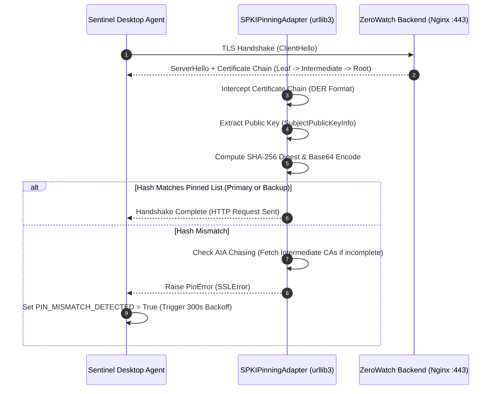

# Feature 01: Certificate Pinning & Public Key Infrastructure (PKI)

---

## 1. Purpose and the Problem It Solves
Endpoint security agents handle highly confidential system inventory data, discovered vulnerabilities, and remote management commands. Standard TLS connection negotiation relies on trusting all hundreds of third-party Certificate Authorities (CAs) installed in the operating system root store. If any CA is compromised, coerced, or if an enterprise intercepts traffic using a corporate decryption proxy (MITM), the agent's telemetry could be inspected or manipulated.

**Certificate Pinning** solves this by restricting valid TLS connections exclusively to specific, pre-authorized Subject Public Key Info (SPKI) cryptographic hashes. Connections will terminate immediately if the server presents any certificate whose public key is not explicitly pinned, neutralizing Man-In-The-Middle (MITM) attacks and rogue CA issuances.

---

## 2. How It Works (Design & Key Implementation Files)



### Key Modules and Code Locations
- **`Endpoint-Agent/common/cert/pinning.py`**: The core, platform-independent SPKI pinning implementation.
  - `get_spki_sha256(der_cert: bytes) -> str`: Extracts the raw public key bytes from a DER-encoded certificate and returns its SHA-256 base64 hash.
  - `PinnedSSLContext` & `SPKIPinningAdapter`: Custom `urllib3` transport adapter that inspects the peer certificate chain during the TLS handshake before transmitting HTTP data.
  - `PinnedSession`: Drop-in replacement for `requests.Session` configured with SPKI validation, non-latching resilient backoff, and loopback bypassing.
  - `register_dynamic_pins(pins: dict)`: In-memory dynamic pin registration verified via Ed25519 signatures.
- **`Endpoint-Agent/cert_pinning.py`**: Legacy forwarder module preserving backward compatibility.
- **`CVE-Engine-V2/backend/utils/generateSpkiHash.js`**: Node.js utility script used by backend operators to extract the SPKI SHA-256 base64 hash from a local certificate or a live remote hostname.

---

## 3. Configuration Options and Defaults

| Parameter / Constant | Location | Default | Description |
| :--- | :--- | :--- | :--- |
| `SPKI_PINS` | `common/cert/pinning.py` | Dual-Pin List | Array of base64-encoded SHA-256 SPKI public key hashes. |
| `OTA_ED25519_PUBLIC_KEY_B64` | `common/cert/pinning.py` | `A05PfsGy...` | Raw 32-byte Ed25519 public key used as the trust anchor for verified OTA updates. |
| `PIN_MISMATCH_COOLDOWN` | `common/cert/pinning.py` | `300` (seconds) | Resilient non-latching backoff cooldown window. |
| `ENABLE_PINNING` | Agent build config | `True` | Master toggle (automatically bypassed for `localhost` and `127.0.0.1`). |

---

## 4. How to Use / Run / Test (With Examples)

### Extracting an SPKI Hash from a Remote Domain
```bash
cd CVE-Engine-V2/backend
node utils/generateSpkiHash.js remote zerowatch.deepcytes.io 443
```
**Output**:
```
SPKI SHA-256 (Base64 Pin):
dK85yRZtQWIab16/niIHoJelcw85aRSZHmkiMhgN3WY=
```

### Running the Python Pinning Test Suite
```bash
cd Endpoint-Agent
pytest tests/test_cert_pinning.py tests/test_cert_pinning_ota.py -v
```

### Initializing a Pinned HTTP Session in Python
```python
from common.cert.pinning import PinnedSession

session = PinnedSession(server_url="https://zerowatch.deepcytes.io")
response = session.get("https://zerowatch.deepcytes.io/api/health")
print("Connection Status:", response.status_code)
```

---

## 5. Dependencies and Integrations
- **Python Client**: `cryptography` (X.509 parsing, SHA-256 hashing), `urllib3` (connection pooling), `requests` (transport adapter).
- **Backend Infrastructure**: Nginx TLS terminator presenting the active X.509 certificate.
- **OTA Integration**: Over-The-Air update server delivering Ed25519-signed dynamic pins.

---

## 6. Failure Modes, Known Limitations and Gotchas
1. **Accidental CA Rotation Outage**: If the server certificate is replaced with a new private key whose SPKI hash was not distributed to the agent fleet, all agents will immediately reject connections.
2. **Intermediate Certificate Omission**: If the server fails to serve the full intermediate certificate bundle, the agent attempts **AIA chasing** (Authority Information Access) to fetch the intermediate cert over HTTP. If outbound HTTP (port 80) is blocked by corporate egress firewalls, AIA chasing will fail.
3. **Loopback Bypassing**: To facilitate local developer testing, connections to `localhost`, `127.0.0.1`, and `::1` bypass pinning automatically (`is_loopback(url)`).

---

## 7. Security Considerations
- **Pinning Public Keys vs. Certificates**: ZeroWatch pins the Subject Public Key Info (SPKI), *not* the entire certificate. This allows certificates to be re-issued with updated expiration dates without altering the public key, preserving compatibility across agent fleets.
- **Non-Latching Recovery**: Early pinning implementations permanently crashed upon pin mismatch. ZeroWatch implements a resilient 5-minute backoff (`PIN_MISMATCH_COOLDOWN`). If a server certificate issue is resolved, agents resume communication automatically.

---

## 8. Open Issues, Technical Debt & Handoff Notes
- [ ] **Technical Debt**: In `Endpoint-Agent/cert_pinning.py`, legacy module-level variables (`PIN_MISMATCH_DETECTED`) exist alongside class-level state in `common.cert.pinning`. Recommend refactoring all callers to use `common.cert.pinning.PinnedSession` directly.
- [ ] **TODO**: Implement automated alerting in the agent when an AIA chase occurs, warning administrators that the server certificate chain is missing intermediate bundles.
