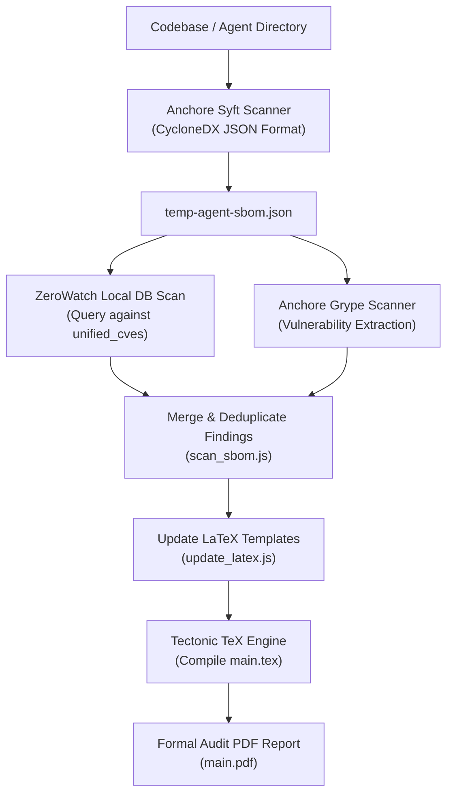

# Feature 03: Software Bill of Materials (SBOM) Generation & Analysis

---

## 1. Purpose and the Problem It Solves
Modern software applications comprise hundreds of direct and transitive open-source dependencies. Security regulations (such as US Executive Order 14028 and EU Cyber Resilience Act) mandate complete transparency into software composition via machine-readable **Software Bills of Materials (SBOM)**. 

ZeroWatch implements a dynamic SBOM pipeline that:
1. Automatically catalogs all binary and source dependencies across the codebase using Anchore Syft.
2. Scans the generated SBOM against both the local ZeroWatch CVE database (`unified_cves`) and Anchore Grype.
3. Compiles formal, vector-rendered LaTeX PDF compliance audit reports using Tectonic TeX.
4. Provides REST endpoints for endpoint agents to upload local desktop SBOMs for centralized tracking.

---

## 2. How It Works (Design & Key Implementation Files)



### Key Modules and Code Locations
- **`Endpoint-Agent/scan_sbom.js`**: Standalone CLI scanner orchestrating Syft generation, database CVE querying, and Grype vulnerability correlation.
- **`Endpoint-Agent/sbom_generation/update_latex.js`**: Parses merged scan findings and dynamically injects metadata, tables, and compliance scores into LaTeX chapters (`chapters/sbom_metadata.tex`, `chapters/compliance_mapping.tex`).
- **`Endpoint-Agent/sbom_generation/tectonic.exe`**: Self-contained, modernized TeX/LaTeX typesetting engine that renders `main.tex` into `main.pdf`.
- **`Endpoint-Agent/.github/workflows/sbom-generation.yaml`**: Automated GitHub Actions workflow executing SBOM audits on every release tag.
- **`CVE-Engine-V2/backend/routes/agentRoutes.js` (`POST /api/agent/sbom`)**: Endpoint accepting client-side CycloneDX/SPDX SBOM payloads and linking them to `agentSbom.js`.

---

## 3. Configuration Options and Defaults

| Option / Variable | Location | Default | Description |
| :--- | :--- | :--- | :--- |
| `SYFT_FORMAT` | `scan_sbom.js` | `cyclonedx-json` | Output format produced by Syft (`cyclonedx-json` or `spdx-json`). |
| `MONGO_URI` | `scan_sbom.js` | `mongodb://localhost:27017/cve-database` | Local CVE database used for immediate package matching. |
| `TECTONIC_BIN` | `sbom_generation/` | `./tectonic.exe` | Executable path for the Tectonic typesetting compiler. |

---

## 4. How to Use / Run / Test (With Examples)

### 1. Generating & Scanning an SBOM Manually
Ensure `syft` and `grype` are installed on your PATH:
```bash
cd Endpoint-Agent
node scan_sbom.js
```
**Console Output**:
```
================================================================================
🔍 DYNAMIC SECURITY SCANNER FOR AGENT (Syft + Grype + Database)
================================================================================
[1/4] Generating CycloneDX SBOM using Syft...
[Syft] Discovered 84 packages across codebase.
[2/4] Correlating packages against local MongoDB unified_cves...
[DB Match] 0 Critical vulnerabilities identified in agent packages.
[3/4] Running Anchore Grype deep vulnerability scanner...
[Grype] Complete. Merging findings...
[4/4] Updating LaTeX compliance chapters and compiling PDF...
[Tectonic] Generating main.pdf...
✅ SUCCESS: Comprehensive SBOM Audit Report compiled to sbom_generation/main.pdf
```

### 2. Ingesting an SBOM via API
```bash
curl -X POST http://localhost:3000/api/agent/sbom \
  -H "Content-Type: application/json" \
  -H "x-device-id: 550e8400-e29b-41d4-a716-446655440000" \
  -d @sample-cyclonedx.json
```

---

## 5. Dependencies and Integrations
- **CLI Tools**: `anchore/syft` (SBOM generation), `anchore/grype` (vulnerability lookup), `tectonic` (LaTeX compilation).
- **Core Engine Integration**: Connects to `unified_cves` to match components against newly published CVEs.
- **CI/CD**: Fully integrated into GitHub Actions release pipelines.

---

## 6. Failure Modes, Known Limitations and Gotchas
1. **Missing PATH Tools**: If `syft` or `grype` is missing from system PATH, `scan_sbom.js` exits immediately with code 1.
2. **LaTeX Font Cache Stalls**: On first execution, `tectonic.exe` attempts to download required TeX packages and fonts over HTTPS. Ensure unrestricted internet connectivity during the initial run.
3. **PURL Parsing Discrepancies**: Package URLs (PURLs) generated for Python virtual environments (`pkg:pypi/requests@2.31.0`) require exact casing when matching against CPE dictionaries.

---

## 7. Security Considerations
- **Transient File Cleanup**: `scan_sbom.js` generates intermediate JSON files (`temp-agent-sbom.json`, `temp-grype.json`). The script uses a `finally` block to ensure all temporary JSON files are purged upon exit, avoiding sensitive file leakage.
- **Dependency Pinning**: The GitHub Actions workflow pins the exact version hashes of Syft and Grype actions to prevent supply-chain attacks.

---

## 8. Open Issues, Technical Debt & Handoff Notes
- [ ] **Technical Debt**: In `update_latex.js`, LaTeX special characters (`_`, `%`, `&`, `#`) in package names are escaped using manual regexes. A dedicated LaTeX sanitizer module should be adopted to prevent TeX syntax compilation errors on unusual package names.
- [ ] **TODO**: Add support for VEX (Vulnerability Exploitability eXchange) statements directly into the generated CycloneDX SBOM to document false-positive justifications.
