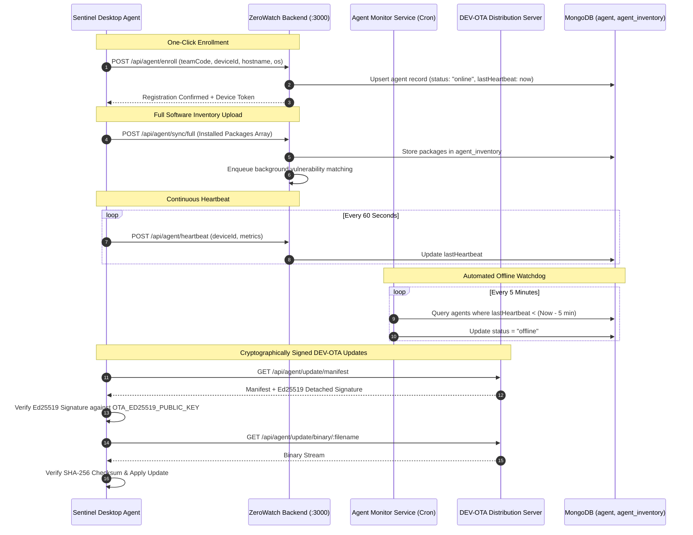

# Feature 07: Cross-Platform Endpoint Desktop Agent & DEV-OTA

---

## 1. Purpose and the Problem It Solves
Accurate enterprise vulnerability management requires complete, live visibility into real-world endpoint software states across developer laptops, office workstations, and on-premise servers. Network port scanners are blind to locally installed libraries, dev tools, and offline assets.

The **ZeroWatch Sentinel Desktop Agent** solves this by running locally on Windows, Linux, and macOS:
1. It continuously captures installed software inventories, package versions, and patch levels.
2. It uploads full and delta package inventories over certificate-pinned HTTPS.
3. It maintains a 60-second keep-alive heartbeat with an automated server-side watchdog.
4. It receives verified binary updates through an Over-The-Air (DEV-OTA) distribution server.
5. It enforces a verified administrative kill-switch protocol for instant decommissioning.

---

## 2. How It Works (Design & Key Implementation Files)



### Key Modules and Code Locations
- **`Endpoint-Agent/`**: Client-side Python codebase compiled into native binaries via Nuitka.
- **`CVE-Engine-V2/backend/routes/agentRoutes.js` & `backend/controllers/agentController.js`**: Core agent REST endpoints:
  - `POST /enroll`: Enrolls workstation using team codes.
  - `POST /heartbeat`: Telemetry keep-alive ping.
  - `POST /sync/full` & `POST /sync/delta`: Ingestion of detected packages.
  - `POST /verify-kill`: Acknowledges administrative device decommission.
- **`CVE-Engine-V2/backend/services/agentMonitorService.js` & `backend/cron/agentOfflineCheckJob.js`**: 5-minute periodic watchdog updating stale agents to `offline`.
- **`CVE-Engine-V2/backend/routes/agentUpdateRoutes.js`**: Serves DEV-OTA update manifests, signatures, and binaries.

---

## 3. Configuration Options and Defaults

| Variable / Setting | Location | Default | Description |
| :--- | :--- | :--- | :--- |
| `AGENT_POLL_INTERVAL_SECONDS` | `backend/.env` | `60` | Recommended heartbeat frequency communicated to agents. |
| `LOG_HEARTBEATS` | `backend/.env` | `false` | Enables console logging for every received heartbeat ping. |
| `AGENT_OFFLINE_THRESHOLD_MS` | `agentMonitorService.js` | `300000` (5m) | Inactivity threshold before marking an agent `offline`. |
| `OTA_ED25519_PUBLIC_KEY_B64` | `common/cert/pinning.py` | *(Fixed Key)* | 32-byte Ed25519 public key used to verify release manifests. |

---

## 4. How to Use / Run / Test (With Examples)

### 1. Simulating Agent Enrollment via Curl
```bash
curl -X POST http://localhost:3000/api/agent/enroll \
  -H "Content-Type: application/json" \
  -d '{
    "teamCode": "SEC-OPS-2026",
    "deviceId": "550e8400-e29b-41d4-a716-446655440000",
    "hostname": "ubuntu-dev-box",
    "os": "linux",
    "osVersion": "Ubuntu 22.04 LTS",
    "ipAddress": "192.168.1.110",
    "macAddress": "00:15:5D:AA:BB:CC",
    "agentVersion": "2.2.0"
  }'
```

### 2. Inspecting the DEV-OTA Manifest
```bash
curl -X GET http://localhost:3000/api/agent/update/manifest
```

---

## 5. Dependencies and Integrations
- **Agent Compiler**: Nuitka compiling Python into standalone native `.exe` or ELF executables.
- **Backend Coupling**: Directly populates `agentInventory.js` and enqueues matching tasks to the GPU Worker.
- **WebSocket Gateway**: Endpoint enrollment pushes real-time device updates to team members in Socket.IO room `agent-{deviceId}`.

---

## 6. Failure Modes, Known Limitations and Gotchas
1. **VM Cloning UUID Collisions**: If a virtual machine image with a pre-enrolled agent is cloned across multiple systems, they will share the same `deviceId`, causing heartbeats to overwrite each other. The agent must regenerate its UUID if hardware BIOS serials change.
2. **Delta Sync Drift**: If network packets are dropped, delta syncs may drift from actual installed packages. The agent executes a mandatory `POST /sync/full` every 24 hours to reset baseline accuracy.

---

## 7. Security Considerations
- **Cryptographic Update Signatures**: The agent will refuse to execute an update binary unless the accompanying manifest is validated against the hardcoded `OTA_ED25519_PUBLIC_KEY_B64`.
- **Kill-Switch Verification**: Decommissioned devices wipe local configuration files and stop transmission immediately upon receiving the verified kill command.

---

## 8. Open Issues, Technical Debt & Handoff Notes
- [ ] **Technical Debt**: In `backend/index.js`, DEV-OTA update routes are marked as developer-only. For enterprise production, binary streaming should be offloaded from Node.js to pre-signed S3 or Cloudflare R2 download URLs.
- [ ] **TODO**: Implement Windows service wrapper and Linux systemd auto-installation scripts in the agent build pipeline.
