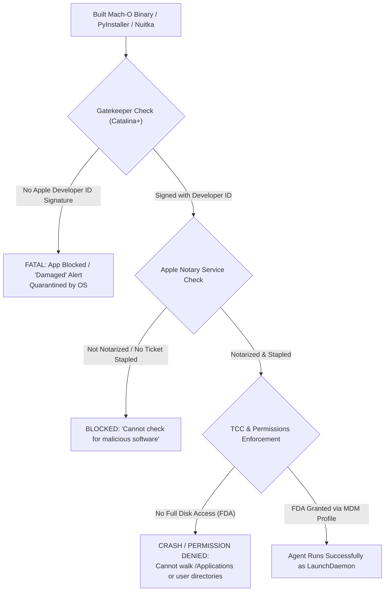
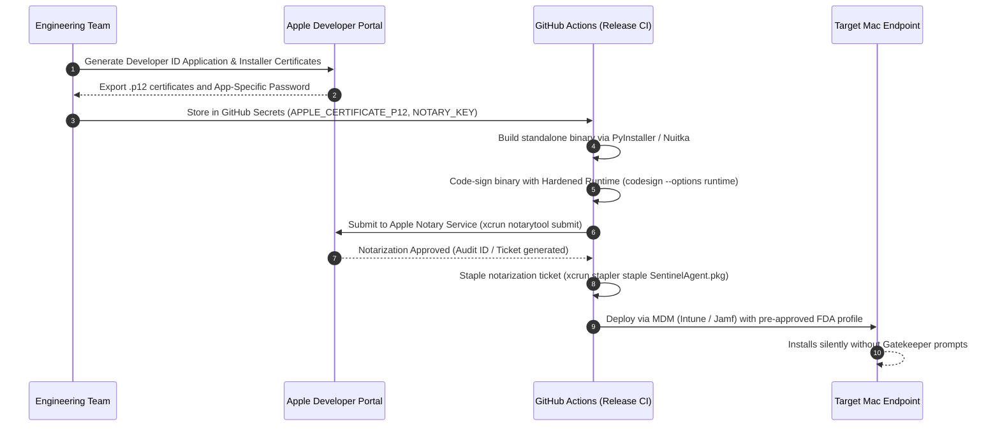

# Decision & Status: macOS Agent On-Hold Due to Security & Ecosystem Blockers

---

## 1. Executive Summary

Development of the macOS Sentinel Agent (`sentinel_agent_macos.py` and `macos/` subsystem) is **currently on hold**. 

While the underlying Python implementation and Darwin platform modules are completely written and functional in local developer environments, releasing and deploying the agent to enterprise macOS end-user devices is blocked by mandatory Apple security architecture requirements—specifically **Gatekeeper code signing enforcement, Apple Notary Service requirements, TCC (Transparency, Consent, and Control) privacy boundaries, and System Integrity Protection (SIP)**.

Without an **active Apple Developer Program enterprise account ($99/year)** and the required Developer ID certificates, distributing the binary will cause macOS to instantly flag it as untrusted malware, block background execution, and fail silent enterprise rollout.

---

## 2. Core Security & Platform Blockers on macOS



### 2.1 Gatekeeper & Unsigned Binary Quarantine
- Since macOS 10.15 (Catalina) and strengthened in macOS 11+ (Big Sur, Sonoma, Sequoia), Gatekeeper enforces that **any executable downloaded from the internet or distributed outside the Mac App Store must be signed with a valid Apple Developer ID Certificate**.
- Unsigned or self-signed binaries are marked with the `com.apple.quarantine` extended file attribute.
- When an end-user attempts to run an unsigned binary, macOS presents a blocking dialog: `"SentinelAgent cannot be opened because the developer cannot be verified"`, and in newer macOS releases, silently quarantines the daemon executable.

### 2.2 Mandatory Apple Notarization Pipeline
- Even if a binary is code-signed, modern macOS strictly requires **Apple Notarization**:
  1. The executable must be built with the **Hardened Runtime** enabled (`--options runtime`).
  2. The binary bundle must be uploaded to Apple's cloud scanning service via `xcrun notarytool`.
  3. Apple's automated notary system inspects the Mach-O binary for suspicious API calls, insecure dynamic library loading, and unsigned shared objects.
  4. Upon approval, an Apple notary ticket is stapled to the binary (`xcrun stapler staple`).
- Without notarization, Gatekeeper refuses to execute the background daemon on macOS 12+ even if signed.

### 2.3 TCC (Transparency, Consent, and Control) & System Integrity Protection (SIP)
- **Filesystem Enumeration Blockers**: SentinelAgent's primary role is software and SBOM inventory scanning. On macOS, scanning `/Applications`, `/Library`, `/Users/*/Library/Application Support`, and command-line tool paths requires broad filesystem read access.
- Under Apple's **TCC framework**, accessing user directories (Desktop, Documents, Downloads, App Data) triggers modal system pop-up dialogues requesting explicit user consent.
- A background daemon cannot respond to or trigger these pop-ups interactively. Without **Full Disk Access (FDA)** granted via System Settings or pre-approved via an Enterprise Mobile Device Management (MDM) configuration profile (`.mobileconfig`), filesystem scans throw `Operation not permitted (Errno 1: EPERM)`.
- **System Integrity Protection (SIP)**: Blocks any agent inspection or process injection into `/System`, `/usr/bin`, and Apple-protected system binaries.

### 2.4 Background Daemon Persistence & LaunchDaemons vs. LaunchAgents
- On macOS, background services cannot simply fork and detach into the background. The OS requires declarative plist configuration files managed by `launchd`:
  - **LaunchDaemons** (`/Library/LaunchDaemons/com.deepcytes.sentinel.plist`): Run as `root` in the system context before login. Requires root privileges to write into `/Library/LaunchDaemons` and execute `launchctl load`.
  - **LaunchAgents** (`/Library/LaunchAgents/`): Run in the context of the logged-in user.
- Without an Apple-signed PKG installer that carries an approved installer certificate (`Developer ID Installer`), standard enterprise software distribution tools (JAMF, Kandji, Microsoft Intune) will reject package deployment.

### 2.5 Endpoint Security Framework (`EndpointSecurity.framework`)
- Real-time file system monitoring and process execution tracking on macOS requires the native **Endpoint Security API**.
- Apple strictly gates the `com.apple.developer.endpoint-security.client` entitlement. This entitlement is **not available by default** even to standard Developer Program members; it requires an explicit manual business petition to Apple proving enterprise EDR capabilities.

---

## 3. What Is Already Built & Ready in the Repo

The macOS subsystem in `SentinelAgent/Zerowatch-EXE/macos/` is **fully architected and code-complete**:

| Module | File Path | Current Status | Capabilities |
| :--- | :--- | :--- | :--- |
| **Main macOS Entry** | `sentinel_agent_macos.py` | Complete | CLI flags, interactive menu, daemon dispatcher, ZeroWatch REST client integration. |
| **Secure Key Storage** | `macos/crypto/keychain_backend.py`<br/>`macos/crypto/security_framework_backend.py` | Complete | Integrates with macOS Keychain Services via `ctypes` bindings to `Security.framework` for encrypted JWT storage. |
| **Hardware Fingerprint** | `macos/hardware/fingerprint.py`<br/>`macos/hardware/hardware_collector.py` | Complete | Extracts Hardware UUID (`IOPlatformUUID` via `ioreg`), CPU architecture (`sysctl hw.model`), MAC addresses, and OS build numbers. |
| **Startup Persistence** | `macos/persistence/startup_manager.py` | Complete | Generates and manages `com.deepcytes.sentinel.plist` for `launchd` registration. |
| **Mach-O Binary Inspector** | `macos/scanner/macho.py`<br/>`macos/scanner/binary_inspector.py` | Complete | Parses Mach-O 32-bit and 64-bit fat binaries, LC_LOAD_DYLIB load commands, code directory hashes, and Info.plist metadata. |
| **Software Collector** | `macos/scanner/software_collector.py`<br/>`macos/scanner/package_collector.py` | Complete | Gathers `.app` bundles from `/Applications`, Homebrew packages (`/opt/homebrew` and `/usr/local`), and pkgutil receipt databases. |
| **Diagnostics & Validation** | `macos/validation/validate_macos.py`<br/>`macos/validation/collect_diagnostics.py` | Complete | Automated test suite validating SIP status, keychain access, hardware collection, and API connectivity. |

---

## 4. Step-by-Step Roadmap to Resume macOS Agent

Once the company procures an **Apple Developer Program membership ($99/yr)**, follow this exact resumption runbook:



### Actionable Resumption Checklist:
1. **Acquire Certificates**:
   - In [developer.apple.com](https://developer.apple.com), generate:
     - `Developer ID Application` (for the executable binary)
     - `Developer ID Installer` (for the `.pkg` distribution installer)
2. **Configure CI/CD Signing Secrets**:
   - Add the following secrets in GitHub repository settings:
     - `MACOS_CERTIFICATE_P12` (base64 encoded `.p12` bundle)
     - `MACOS_CERTIFICATE_PASSWORD`
     - `APPLE_ID` (team account email)
     - `APPLE_TEAM_ID` (10-character team ID)
     - `APPLE_APP_SPECIFIC_PASSWORD` (for `notarytool` authentication)
3. **Execute Signing & Notarization Commands**:
   ```bash
   # 1. Sign executable with Hardened Runtime
   codesign --force --options runtime --timestamp \
     --sign "Developer ID Application: Deepcytes Inc (TEAMID1234)" \
     --entitlements macos/resources/entitlements.plist \
     dist/sentinel_agent_macos

   # 2. Package into Installer .pkg
   productbuild --sign "Developer ID Installer: Deepcytes Inc (TEAMID1234)" \
     --component dist/sentinel_agent_macos /usr/local/bin/sentinel_agent \
     SentinelAgent.pkg

   # 3. Notarize with Apple
   xcrun notarytool submit SentinelAgent.pkg \
     --apple-id "$APPLE_ID" \
     --team-id "$APPLE_TEAM_ID" \
     --password "$APPLE_APP_SPECIFIC_PASSWORD" \
     --wait

   # 4. Staple Notary Ticket
   xcrun stapler staple SentinelAgent.pkg
   ```
4. **Distribute MDM Privacy Profile**:
   - Create and sign a `.mobileconfig` payload granting Full Disk Access (`kTCCServiceSystemPolicyAllFiles`) to bundle ID `com.deepcytes.sentinel` so client machines do not display permission prompts.
