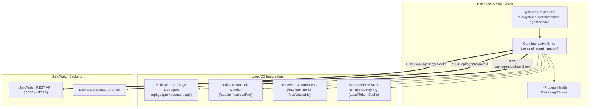

# Platform Architecture Guide: Linux Sentinel Agent

---

## 1. Overview & Purpose

The **Linux Sentinel Agent** (`sentinel_agent_linux.py` and `linux/` subsystem) provides automated vulnerability telemetry, software inventory collection, and security monitoring across diverse Linux distributions (Debian, Ubuntu, RHEL, CentOS, Rocky Linux, Fedora, Alpine, Arch Linux).

It runs natively as a **systemd service** or unprivileged daemon process, communicating securely with ZeroWatch using certificate pinning and Ed25519-signed OTA updates.

---

## 2. Linux Architecture & Component Flow



---

## 3. Key Modules and Code Locations

| Subsystem | File Path | Description |
| :--- | :--- | :--- |
| **Main Linux Entry** | `sentinel_agent_linux.py` | CLI flags (`--daemon`, `--sync`, `--status`, `--enroll`), systemd integration hooks, and runtime loop. |
| **Linux Platform Entry** | `linux/platform.py` | Distribution detector (parses `/etc/os-release`), user permission checks, and POSIX signal handlers. |
| **Package Collector** | `linux/scanner/package_collector.py` | Multi-engine package inspector: executes native package commands without heavy shell overhead. |
| **Dynamic File Watcher** | `linux/scanner/file_watcher.py` | Uses Linux `inotify` subsystem via `select`/`epoll` to track added or updated binary executables in real time. |
| **Hardware Collector** | `linux/hardware/hardware_collector.py`<br/>`linux/hardware/fingerprint.py` | Extracts `/etc/machine-id`, `/sys/class/dmi/id/product_uuid`, CPU flags from `/proc/cpuinfo`, and NIC MAC addresses. |
| **Secure Key Store** | `linux/crypto/secure_store.py` | Encrypts device JWT tokens using the Linux Secret Service API (via DBus / `libsecret`) with local AES-256 fallback. |
| **Persistence Manager** | `linux/persistence/startup_manager.py` | Generates, installs, and enables systemd service files (`sentinel-agent.service`). |
| **OTA Updater Engine** | `common/ota/updater.py` | Verifies and applies Linux ELF binary updates, restores executable permissions (`chmod +x`), and triggers systemd reload. |

---

## 4. Multi-Distro Software Discovery Engine

Linux systems distribute software across varied package management ecosystems. The Linux scanner dynamically detects the active distribution and queries the appropriate package manager:

| Package Manager | Distributions | Detection Command & Parser |
| :--- | :--- | :--- |
| **`dpkg` / `apt`** | Debian, Ubuntu, Linux Mint, Kali | `dpkg-query -W -f='${Package}\t${Version}\t${Architecture}\n'` |
| **`rpm` / `dnf`** | RHEL, CentOS, Fedora, Rocky, AlmaLinux | `rpm -qa --qf '%{NAME}\t%{VERSION}-%{RELEASE}\t%{ARCH}\n'` |
| **`pacman`** | Arch Linux, Manjaro | `pacman -Q` |
| **`apk`** | Alpine Linux (Containers / Lightweight VMs) | `apk info -v` |
| **Manual / Snap / Flatpak** | Cross-distro sandboxed packages | Checks `/snap/bin`, `/var/lib/flatpak`, `/opt`, and `/usr/local/bin`. |

---

## 5. Security & Permission Hardening

1. **Least-Privilege Execution**:
   - The agent does **not** require full `root` privileges for regular operation.
   - For restricted filesystem inspection, Linux file capabilities can be assigned instead of full SUID:
     ```bash
     sudo setcap cap_dac_read_search+ep /usr/local/bin/sentinel_agent
     ```
2. **Systemd Service Isolation**:
   - The generated systemd unit incorporates modern Linux security hardening primitives:
     ```ini
     [Unit]
     Description=ZeroWatch Sentinel Endpoint Agent
     After=network.target

     [Service]
     Type=simple
     User=sentinel-agent
     ExecStart=/usr/local/bin/sentinel_agent --daemon
     Restart=always
     RestartSec=10
     ProtectSystem=full
     ProtectHome=read-only
     NoNewPrivileges=true

     [Install]
     WantedBy=multi-user.target
     ```
3. **Cryptographic Certificate Pinning**:
   - Uses `common/cert/pinning.py` to enforce client-side TLS SPKI SHA-256 certificate pinning, guarding against local proxy interception or corporate TLS inspection middleboxes.

---

## 6. How to Build & Run on Linux

### 1. Running in Development
```bash
python3 -m venv venv
source venv/bin/activate
pip install -r requirements.txt

# Run interactive CLI:
python sentinel_agent_linux.py

# Run in background daemon mode:
python sentinel_agent_linux.py --daemon
```

### 2. Compiling with Nuitka
```bash
cd linux/build
bash build_agent.sh
```
Output executable: `dist/sentinel_agent_linux`.
