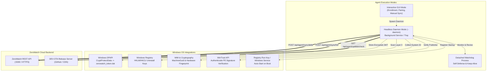

# Platform Architecture Guide: Windows Sentinel Agent

---

## 1. Overview & Purpose

The **Windows Sentinel Agent** (`sentinel_agent.py` and `windows/` subsystem) is ZeroWatch's primary, enterprise-grade desktop security sensor for Microsoft Windows (Windows 10, Windows 11, Windows Server 2016–2022).

It performs four mission-critical functions:
1. **Device Enrollment & Cryptographic Identity**: Generates unique, immutable hardware fingerprints and establishes authenticated mTLS/JWT sessions with the ZeroWatch backend.
2. **Two-Tier Software & Hardware Inventory**: Scans installed applications via the Windows Registry (32-bit and 64-bit WOW6432Node), file system directory trees, and PE Authenticode digital signature headers.
3. **Heartbeat, Health & Tamper Self-Defense**: Maintains continuous heartbeats with the backend, guards local credentials using Windows DPAPI, and runs an anti-termination watchdog.
4. **DEV-OTA Autonomous Updates**: Automatically checks, validates Ed25519 signatures, and atomically replaces itself in the background when new agent versions are published.

---

## 2. Windows Architecture & Component Flow



---

## 3. Key Modules and Code Locations

| Subsystem | File Path | Description |
| :--- | :--- | :--- |
| **Main Orchestrator** | `sentinel_agent.py` | Command Center UI (Tkinter), CLI dispatcher (`--daemon`, `--sync`, `--enroll-silent`, `--watchdog`), and lifecycle loop. |
| **Windows Platform Entry** | `windows/platform.py` | Platform abstraction implementing initialization, permission elevation, and platform hooks. |
| **Layer 0 Registry Scanner** | `windows/scanner/layer0_registry.py` | Enumerates 64-bit and 32-bit uninstall keys (`HKLM\Software\Microsoft\Windows\CurrentVersion\Uninstall` and `HKLM\Software\WOW6432Node\Microsoft\Windows\CurrentVersion\Uninstall`). |
| **Layer 1 Path Walker** | `windows/scanner/layer1_paths.py` | Discovers portable applications and developer tools in `Program Files`, `Program Files (x86)`, `%APPDATA%`, and `%LOCALAPPDATA%`. |
| **Binary Inspector** | `windows/scanner/binary_inspector.py` | Extracts PE header metadata, company names, product versions via `VS_FIXEDFILEINFO`, and validates Authenticode signatures. |
| **Hardware Collector** | `windows/hardware/hardware_collector.py`<br/>`windows/hardware/fingerprint.py` | Gathers Motherboard UUID, CPU ID, MAC addresses, and `MachineGuid` from `HKLM\SOFTWARE\Microsoft\Cryptography`. |
| **DPAPI Credential Storage** | `windows/crypto/dpapi_backend.py`<br/>`windows/crypto/secure_store.py` | Encrypts device tokens and API secrets with `win32crypt.CryptProtectData`, tying decryption strictly to the current Windows user and machine. |
| **Persistence Manager** | `windows/persistence/startup_manager.py` | Configures auto-start via Registry Run (`HKCU\Software\Microsoft\Windows\CurrentVersion\Run`) or Windows Service (`sc.exe`). |
| **OTA Updater Engine** | `common/ota/updater.py` | Downloads new agent binaries, verifies SHA-256 and Ed25519 digital signatures, and performs atomic binary swap via `.new` file renaming. |

---

## 4. Software Inventory Collection Details

Windows software discovery operates in two sequential layers:

### Layer 0: Windows Registry Enumeration
The agent iterates across both 64-bit and 32-bit Registry hives:
1. `HKLM\SOFTWARE\Microsoft\Windows\CurrentVersion\Uninstall`
2. `HKLM\SOFTWARE\WOW6432Node\Microsoft\Windows\CurrentVersion\Uninstall`
3. `HKCU\SOFTWARE\Microsoft\Windows\CurrentVersion\Uninstall` (User-installed software like VS Code user installs, Discord, Slack)

For each subkey, it extracts:
- `DisplayName`, `DisplayVersion`, `Publisher`, `InstallLocation`, `InstallDate`, `QuietUninstallString`.
- Normalizes vendor names and filters out standard Windows update packages (KB patches) to focus on targetable third-party software.

### Layer 1: Filesystem Walking & Authenticode PE Inspection
For applications that do not register in the Windows Registry (e.g., portable tools, developer runtimes like Python, Go, Node.js):
1. Traverses `%PROGRAMFILES%`, `%PROGRAMFILES(X86)%`, `%LOCALAPPDATA%\Programs`.
2. Inspects executable binaries (`.exe`, `.dll`) by reading the Portable Executable (PE) headers using `ctypes`.
3. Calls Windows `WinVerifyTrust` (`wintrust.dll`) to verify if the binary is digitally signed by a trusted root Certificate Authority.

---

## 5. Security & Self-Defense Mechanisms

1. **Windows DPAPI Token Isolation**: Device JWT tokens are never stored in plaintext JSON or INI files. They are encrypted using `CryptProtectData` (`CRYPTPROTECT_UI_FORBIDDEN`) and written to `zerowatch_token.dat`. Only the identical Windows user account on that specific hardware can decrypt it.
2. **Anti-Termination Watchdog**:
   - The agent spawns a detached watchdog process (`sentinel_agent.py --watchdog <PARENT_PID>`).
   - If the main agent process is terminated or killed via Task Manager, the watchdog immediately restarts the agent.
   - If a manual shutdown is requested from the UI, an authorized admin PIN/password must be entered to terminate both processes cleanly.
3. **Antivirus & SmartScreen Heuristic Handling**:
   - Running low-level Windows APIs (`OpenProcess`, Registry walking, DPAPI) can trigger generic heuristic flags in Windows Defender or EDR solutions.
   - Production builds are signed using an enterprise **Extended Validation (EV) Code Signing Certificate**.
   - A dedicated non-blocking heartbeat thread (`monitor_thread`) starts *before* intensive filesystem scans begin to prevent watchdog timeout flags in Windows Service Control Manager.

---

## 6. How to Build & Run on Windows

### 1. Running in Development (Python)
```powershell
# Create and activate virtual environment
python -m venv venv
.\venv\Scripts\Activate.ps1
pip install -r requirements.txt

# Run interactive Command Center:
python sentinel_agent.py

# Run in headless daemon mode:
python sentinel_agent.py --daemon
```

### 2. Building Standalone Binary with Nuitka
The Windows agent is compiled using **Nuitka + MSVC / Zig** for maximum performance and reverse-engineering resistance:
```powershell
.\build_agent.bat
```
Output executable: `dist\sentinel_agent.exe`.
